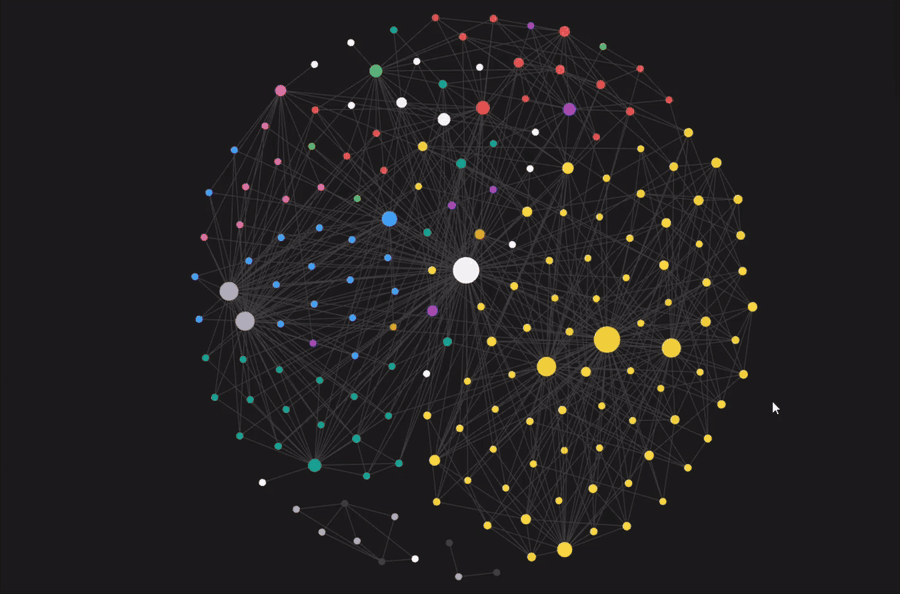

# SecOn Dbrain

SecOn Dbrain transforma seus livros, documentações técnicas e anotações em um RAG local acessível por MCP para o fundamentar respostas do seu modelo de IA sem torrar seus tokens desnecessariamente. Adicione PDFs e Markdown, prepare a base de consulta com processamento local e peça ao assistente de IA para consultar os trechos relevantes com referências às fontes. A preparação local não utiliza seu modelo de IA, já a conversa e os resumos opcionais usam o modelo da sua preferência.

## Visualização do conhecimento



Uma coleção organizada pode ser explorada como um grafo no Obsidian, com conexões entre fontes, notas e mapas. Essa visualização é opcional e depende dos links entre as notas; a IA consulta as evidências pelo RAG/MCP. O GIF usa um trecho ilustrativo sem áudio, títulos pessoais ou páginas dos materiais.

Veja os [exemplos e prompts de uso do MCP](docs/usage.md#checklist-rápido-e-prompts) para consultar sua própria coleção.

## Pastas da coleção

O projeto é desenvolvido a partir do seu material adicionado nas duas áreas de entrada para fontes: `PDFs/` e `Markdown/` que servirão como a base para a construção de conhecimento consultável para o seu modelo de IA. Os arquivos originais são preservados em seu estado original, mantendo seus nomes, conteúdo e sua localização. Notas, mapas, procedimentos, experimentos e resumos desenvolvidos a partir desse material ficam em `Conhecimento/`.

| Pasta | Conteúdo | Busca |
|---|---|---|
| `PDFs/` | Fontes originais em PDF | Sim |
| `Markdown/` | Fontes originais em Markdown | Sim |
| `Conhecimento/00-Inicio/` | Orientações e mapas locais | Sim |
| `Conhecimento/10-Fontes/` | Fichas bibliográficas e estudos de caso | Sim |
| `Conhecimento/20-Notas/` | Resumos e conceitos derivados das fontes | Sim |
| `Conhecimento/30-Procedimentos/` | Procedimentos e checklists derivados, quando pertinentes | Sim |
| `Conhecimento/40-Experimentos/` | Sínteses de experimentos já documentados nas fontes | Sim |
| `Conhecimento/90-Templates/` | Modelos para novas notas | Não |
| `.dbrain/` | Índice, cache e dados derivados regeneráveis | Não é fonte |

Templates são editáveis e não são indexados. Os guias README explicam cada pasta e também são excluídos da busca.

Para o uso comum, adicione material somente nas duas entradas "PDFs" e "Markdown". O comando `prepare` gera fichas e mapas locais; o enriquecimento opcional grava resumos em `Conhecimento/20-Notas/`. As demais categorias permitem curadoria avançada, que podem ser preenchidas com apoio do modelo de IA da sua preferência. 

## Como as camadas funcionam

- **Bronze:** PDFs e Markdown originais preservados.
- **Silver:** texto extraído, trechos, embeddings, índice lexical FTS5 e vetorial, fusão RRF e mapas heurísticos locais baseados em termos, sem afirmar relações semânticas verificadas. Esses dados ficam em `.dbrain/` e podem ser reconstruídos a partir das fontes e da configuração.
- **Gold:** resumos opcionais e progressivos, preparados pelo assistente a partir de tarefas de enriquecimento e gravados em `Conhecimento/`. Cada resumo deve citar as unidades de evidência fornecidas, como páginas físicas ou seções. Ele começa como rascunho com status `needs-review`.

## Modelo de busca híbrida

A busca híbrida combina BM25 (palavras-chave, via SQLite FTS5) e similaridade entre embeddings locais (busca semântica), ordenando os resultados por fusão RRF. O modelo recebe trechos selecionados por pergunta. Sínteses ajudam a navegação e não substituem a recuperação do texto original. Mapas e fichas locais recebem versões de conteúdo; versões antigas continuam preservadas e deixam de ser recuperadas quando suas referências ficam obsoletas.

`prepare` mantém os mapas gerados `Conhecimento/00-Inicio/Mapa geral do acervo.md` e `Mapa de temas.md`, com IDs persistentes e histórico local em `.dbrain/knowledge/history/maps/`.

O assistente pode produzir resumos por meio das ferramentas MCP de enriquecimento, se o servidor tiver escrita opt-in habilitada. 

## Início rápido

Requer Python 3.12 e Git. O guia [Uso](docs/usage.md) descreve instalação para Windows e Ubuntu 24.04, preparação, busca e integração opcional com MCP.

### Windows

```powershell
git clone https://github.com/Shyedda/secon-dbrain-mcp.git
Set-Location secon-dbrain-mcp
python Sistema/setup_environment.py
.venv\Scripts\python.exe Sistema/dbrain.py setup-model
```

Copie fontes para `PDFs/` ou `Markdown/` e prepare o índice. A preparação inicial pode levar tempo; execute-a em um terminal próprio.

```powershell
.venv\Scripts\python.exe Sistema/dbrain.py prepare --wait 900
.venv\Scripts\python.exe Sistema/dbrain.py search 'tema ou pergunta'
```

### Ubuntu 24.04 x86_64

```bash
sudo apt update
sudo apt install git python3.12 python3.12-venv
git clone https://github.com/Shyedda/secon-dbrain-mcp.git
cd secon-dbrain-mcp
python3.12 Sistema/setup_environment.py
.venv/bin/python Sistema/dbrain.py setup-model
```

Depois de copiar fontes para `PDFs/` ou `Markdown/`:

```bash
.venv/bin/python Sistema/dbrain.py prepare --wait 900
.venv/bin/python Sistema/dbrain.py search 'tema ou pergunta'
```

Processamento e busca ocorrem localmente.

## Código compartilhado e coleção privada

As cópias pública e privada usam a mesma implementação da ferramenta; a configuração, o esquema, os templates, o skill personalizado e o acervo podem variar por coleção. O Git privado pode continuar versionando notas e resumos. O pacote público exportado contém a estrutura genérica, sem originais, notas ou resumos da coleção privada.

Para comparar a implementação de duas cópias, use `Sistema/runtime_manifest.py --check` e `Sistema/runtime_manifest.py --compare OUTRO_ROOT`. O manifesto compara fingerprints do código, testes, skills genéricas e guia de uso. Ele exclui configurações e esquema da coleção, corpus, templates, skill personalizado e README do acervo. Para levar mudanças ao repositório público, exporte o pacote a partir do mesmo código e confira os fingerprints; esse fluxo é manual e não sincroniza os repositórios automaticamente.

## Agentes e MCP

O MCP oferece `search_knowledge`, `read_knowledge`, `knowledge_status`, `knowledge_overview` e `read_enrichment_task` em modo de leitura. `prepare_knowledge`, `plan_enrichment` e `submit_enrichment` são escritores ativados com `--allow-writes`; o instalador pode gerar essa configuração com a mesma opção. A CLI `prepare` é preferível para a preparação inicial, que pode demorar (depende da quantidade de material disponível nas pastas PDF e Markdown).

As skills empacotadas `dbrain-setup` e `dbrain-enrichment` orientam, respectivamente, a configuração e o enriquecimento por lotes. Consulte [Uso](docs/usage.md) para os nomes e parâmetros disponíveis.

## Adaptar à sua coleção

O esquema inicial usa somente a área `geral`. Defina suas próprias áreas e classificações em `Sistema/schema.json`; sinônimos opcionais de busca ficam em `lexical_expansions`, em `Sistema/config.json`. Os padrões distribuídos são independentes de qualquer biblioteca pessoal. Veja [Personalizar o contexto da coleção](docs/usage.md#personalizar-o-contexto-da-coleção).

## Evidência e privacidade

Resultados são candidatos de recuperação. Verifique afirmações importantes nas fontes originais e cite a fonte com a página física do PDF ou seção/linhas do Markdown. Extração pode perder estrutura ou conteúdo, e mapas heurísticos podem errar. Não invente resultados de experimentos. Resumos não substituem as fontes e devem permanecer em revisão até serem conferidos.

O processamento local não envia automaticamente toda a coleção. Trechos fornecidos ao MCP podem chegar ao provedor de IA escolhido para a conversa. Não indexe segredos nem material que não possa ser compartilhado com esse serviço.
